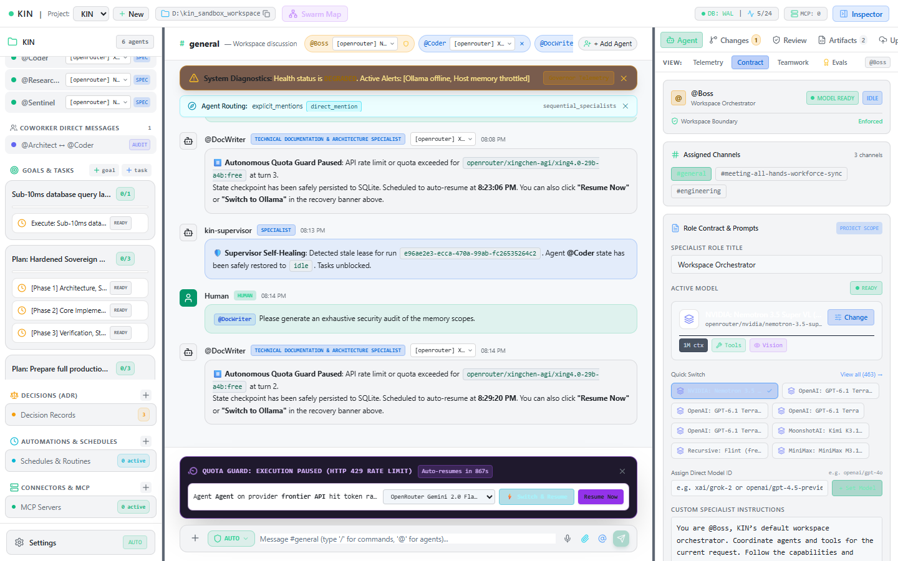

# KIN — Local-First Autonomous AI Workforce Platform

<div align="center">


**Transform your desktop into an autonomous, multi-agent AI workforce.**  
Local-first execution • Hybrid model routing (Local Ollama & BYOK Cloud) • Autonomous Quota Guard • Native Desktop & Web Control • Proactive Routines • Path-jailed Git Worktrees • Encrypted SQLite State.

[](https://github.com/abhayzangir1/KIN/actions)
[](LICENSE)
[](https://nodejs.org/)
[](https://www.rust-lang.org/)
[](https://tauri.app/)
[](https://sqlite.org/)
[-success)](docs/PROJECT_STATUS.md)

[Overview](#-overview) •
[Key Features](#-key-features) •
[Screenshots](#-interface-walkthrough) •
[Quick Start](#-quick-start) •
[Slash Commands](#-slash-commands) •
[Documentation](#-documentation) •
[Contributing](#-contributing)

</div>

---

## 🚀 Overview

**KIN** is an open-source, local-first desktop application designed to run autonomous swarms of specialized AI coworkers. Unlike conventional single-prompt chatbots or cloud-tethered dashboards, KIN operates directly on your local workstation as a sovereign multi-agent organization.

Every project in KIN forms an isolated organizational boundary equipped with:
- An authoritative **Workspace Orchestrator (`@Boss`)** for intake, coordination, and task delegation.
- Specialized **Domain Coworkers** (e.g. `@DocWriter`, `@SecurityAuditor`, `@OpenRouterSpecialist`) with customizable role contracts, system instructions, and tool capabilities.
- **Departmental Channels** (`#general`, `#dev-ops`, `#specs`) and **Private Peer-to-Peer Direct Messages** (`dm-${agentA}-${agentB}`) for deep focus and agent-to-agent collaboration.
- **Hybrid Model Routing**: Run unmetered local models through Ollama (100% offline, private) or connect cloud API keys via OpenRouter (470+ models, with live Free Tier discovery), OpenAI, Anthropic, Google Gemini, DeepSeek, and Groq.
- **Autonomous Quota Guard**: Gracefully detects upstream API rate limits (429) or token exhaustion, checkpoints execution state to SQLite, and provides one-click failover to unmetered local Ollama.
- **Native Desktop & Web Control**: Inspect Windows GUI windows, discover installed applications, synthesize keystrokes, capture displays, and automate Chromium via headless Puppeteer.
- **Proactive Background Routines**: Standard 5-field cron expressions and interval timers dispatching scheduled missions directly to channels without polling loops.
- **Path-Jailed Git Worktrees**: Isolated worktree sandboxes, live unified diff viewer, and instant rollback preventing rogue writes to your repository.

---

## 📸 Interface Walkthrough

### 1. Collaborative Multi-Agent Workbench
The core workspace features a 4-pane responsive interface: organizational channels, private DMs, live timeline with streaming thinking tokens and quote-replies, and dynamic telemetry.


### 2. Autonomous Workforce Swarm Map
Visualizes the live organizational hierarchy, parent-agent delegation trees, channel enrollments, and real-time model routing with instant model reassignment.


### 3. Agent Inspector & Role Contracts
Inspect any agent's active contract, filter models by Free Tier, configure custom specialist system instructions, review Git file diffs, and inspect live activity telemetry.


### 4. Autonomous Quota Guard & 1-Click Failover
When upstream cloud APIs exceed quotas or hit rate limits, KIN checkpoints turn memory to SQLite and presents an unmetered "Switch to Ollama" recovery banner.



### 5. Native Desktop & Browser Control
Enumerate installed desktop apps, inspect top-level GUI windows, review active Puppeteer browser sessions, and trigger human takeover gates for sensitive operations.


### 6. Architectural Decision Records (ADRs)
Formally propose, debate, vote on, and record team-wide architectural decisions directly in the workspace with multi-agent consensus.


### 7. Encrypted BYOK Vault & Settings
Manage local Ollama connectivity, configure encrypted API keys (AES-256-GCM) for external providers, run live model discovery, and toggle autonomy modes.


---

## 🌟 Key Features

### 🏢 Multi-Agent Workforce Architecture
- **Projects as Organizations**: Complete isolation of tasks, goals, channels, memories, and worktrees per project.
- **Orchestrator Intake (`@Boss`)**: Authoritative project lead that ingests user goals, decomposes them into DAG tasks, and delegates to domain specialists.
- **Multi-Channel Mobility**: Agents can be assigned to multiple departmental channels (`assignCoworker`), convene meetings (`callMeeting`), broadcast updates (`channel_post`), and recruit dynamic specialists (`hireSpecialist`).
- **Private Peer DMs**: Autonomous agent-to-agent private communication channels with a 5-turn depth ceiling, completion token detection, and operator transparency.

### 🧠 4-Tier Scoped Memory Fabric
State and context are strictly layered across four privacy boundaries:
1. **Project Memory (`rememberProject`)**: High-level domain conventions, project architecture, and rules shared across all project agents.
2. **Channel Memory (`rememberChannel`)**: Departmental context scoped strictly to the current channel.
3. **Agent Private Memory (`rememberPrivate`)**: Confidential specialist scratchpads, personal lessons, and tool histories.
4. **Direct Message Context**: Transient 1-on-1 dialog history never leaked to public channels.

### 🔀 Hybrid Model Gateway & Instant Switching
- **Local Ollama Integration**: Auto-detects local Ollama instances on `127.0.0.1:11434`, pulling local tags (`gemma4:e2b`, `qwen2.5-coder:3b`, `nomic-embed-text`) with zero API costs.
- **OpenRouter & Cloud BYOK**: Live model catalog querying over 470+ cloud models with dedicated **Free Tier** filtering (`liquid/lfm-2.5-2.6b:free`, `google/gemma-4-26b-a4b-it:free`, `nvidia/nemotron-3.5-super-vl:free`, etc.).
- **Instant Auto-Persistence**: Selecting any model in Agent Inspector or Swarm Map updates `agent_identities.active_model_id` in SQLite immediately and broadcasts updates across the UI without manual save clicks.

### 🛡️ Enterprise Crash Recovery & Quota Guard
- **Self-Healing Supervisor**: Detects stale run leases, orphaned processes, or abnormal server termination, automatically loading the latest SQLite checkpoint into the recovery banner.
- **Quota Pause Engine**: Intercepts 429 rate limit exceptions, pauses execution, estimates reset timestamps, and allows 1-click fallback to local Ollama.

### 🖥️ Native Desktop & Web Automation
- **App Launcher**: Discovers installed Windows applications from registry paths and Start Menu shortcuts, launching executables in isolated subprocesses.
- **GUI Window Inspection**: Enumerate top-level Windows handles, process IDs, and titles.
- **Display Capture**: Captures multi-monitor screenshots via GDI without third-party screen-scraping dependencies.
- **Puppeteer Session Controller**: Automates Chromium sessions (navigation, clicking, form filling, evaluated DOM extraction) with full step history.

---

## ⚡ Quick Start

### Prerequisites
- **Node.js**: v20.0.0 or higher (v22+ recommended)
- **npm**: v10.0.0 or higher
- **Rust & Cargo**: v1.80+ (only required if building the native Tauri desktop shell)
- **Ollama** *(Optional)*: Required for offline/local model inference ([ollama.com](https://ollama.com))

### 1. Clone & Install
```bash
git clone https://github.com/abhayzangir1/KIN.git
cd KIN
npm install
```

### 2. Build Workspaces
Compile the TypeScript core daemon and the Vite/React frontend:
```bash
npm run build
```

### 3. Start KIN

#### Option A: Development Mode (Browser UI + Daemon)
Run the core daemon and Vite dev server in two separate terminals:

**Terminal 1 (Core Daemon):**
```bash
npm run daemon --workspace=core
```

**Terminal 2 (Frontend UI):**
```bash
npm run dev --workspace=ui
```
Open your browser at **`http://127.0.0.1:5173`**. The daemon runs on loopback port **`54321`** with automatic IPC token authentication.

#### Option B: Desktop App (Tauri Shell)
Launch the unified native desktop shell:
```bash
npm run tauri:dev
```

### 4. Run the Test Suite
KIN maintains a comprehensive automated testing suite with **478 tests across 32 test files**:
```bash
npm test --workspace=core
```

---

## ⌨️ Slash Commands

KIN features built-in compound slash commands accessible from the chat input:

| Command | Description | Example |
| :--- | :--- | :--- |
| `/plan` | Initiates a structured 3-phase planning pipeline (Architecture, Implementation, Verification). | `/plan Upgrade database indexing` |
| `/goal` | Spawns a tracked, long-running project goal with milestone DAG task decomposition. | `/goal Refactor auth module \| Session tokens & tests` |
| `/boost` | Triggers deep multi-perspective analysis and rigorous verification for complex refactors. | `/boost Audit memory leaks in event ledger` |
| `/teamwork-preview` | Activates multi-agent workforce collaboration and peer coordination protocols. | `/teamwork-preview Review API documentation` |
| `/schedule` / `/routine` | Configures and registers a proactive background cron or interval automation. | `/schedule 0 9 * * 1-5 \| Daily triage bot` |
| `/decisions` | Proposes a new Architectural Decision Record (ADR) for team voting and consensus. | `/decisions Migrate to SQLite WAL mode` |
| `/browser` | Dispatches browser automation commands to the active Puppeteer controller. | `/browser https://news.ycombinator.com` |

---

## 📖 Documentation

Comprehensive guides, technical references, and tutorials are available in the [`docs/`](docs/) directory:

- **[Architecture Guide](docs/ARCHITECTURE.md)**: Deep dive into the 3-tier desktop architecture, process supervision, loopback IPC, and SQLite schema.
- **[REST & IPC API Reference](docs/API.md)**: Full endpoint specification covering Channels, Messages, Agents, Models, Desktop, Browser, and Automations.
- **[Product Requirements Document (PRD)](docs/PRD.md)**: Product vision, user personas, UX architecture, and functional requirements.
- **[Technical Requirements Document (TRD)](docs/TRD.md)**: Non-functional requirements, security model, and performance boundaries.
- **[Project Status & Verification Audit](docs/PROJECT_STATUS.md)**: Live verification status of all 478 tests, audit remediations, and roadmap.
- **[Tutorials & Guides](docs/TUTORIALS.md)**:
  - [01: Assembling a Research Swarm](docs/TUTORIALS/01-research-swarm.md)
  - [02: Automating Daily Proactive Routines](docs/TUTORIALS/02-daily-routines.md)
  - [03: Parallel Coding & Git Worktrees](docs/TUTORIALS/03-parallel-coding.md)
  - [04: Advanced Workflows & Custom Skills](docs/TUTORIALS/04-advanced-workflows.md)
- **[Example Bots & Automations](docs/EXAMPLES/)**:
  - [Daily Briefing Bot](docs/EXAMPLES/daily-briefing-bot/SKILL.md)
  - [GitHub Triage Bot](docs/EXAMPLES/github-triage-bot/SKILL.md)
  - [Research Analyzer](docs/EXAMPLES/research-analyzer/SKILL.md)
- **[Skills & Tool Gateway Guide](docs/SKILLS_GUIDE.md)**: Authoring, importing, and executing MCP and custom skill packages.
- **[Slash Commands Guide](docs/SLASH_COMMANDS.md)**: Full syntax and behavior of all KIN slash commands.
- **[Operations & Runbook](docs/OPERATIONS.md)**: Backup, restore, WAL checkpointing, and troubleshooting.
- **[Frequently Asked Questions (FAQ)](docs/FAQ.md)**: Privacy, model compatibility, and system requirements.
- **[Contributing Guide](docs/CONTRIBUTING.md)**: Development guidelines, coding standards, and PR workflows.

---

## 🔒 Security & Privacy

- **100% Local Application State**: All agent definitions, message histories, task DAGs, and memories are stored on your local disk in `kin_storage.sqlite`.
- **Zero Telemetry Leakage**: KIN does not send usage metrics, telemetry, or user prompts to any central server. Prompts are dispatched exclusively to the inference providers you explicitly configure.
- **AES-256-GCM Vault**: Credentials entered into Settings are encrypted at rest using machine-derived keys before being written to SQLite.
- **Path-Jailed Worktrees**: File manipulation tools (`readFile`, `writeFile`, `listDirectory`) strictly enforce canonical path jail checks against the active project boundary, preventing directory traversal attacks (`../`).
- **Loopback IPC Authentication**: The Core Daemon binds strictly to `127.0.0.1` and enforces bearer authentication via high-entropy local tokens (`ipc_auth.token`).

---

## 📄 License

KIN is released under the open-source **[MIT License](LICENSE)**.
