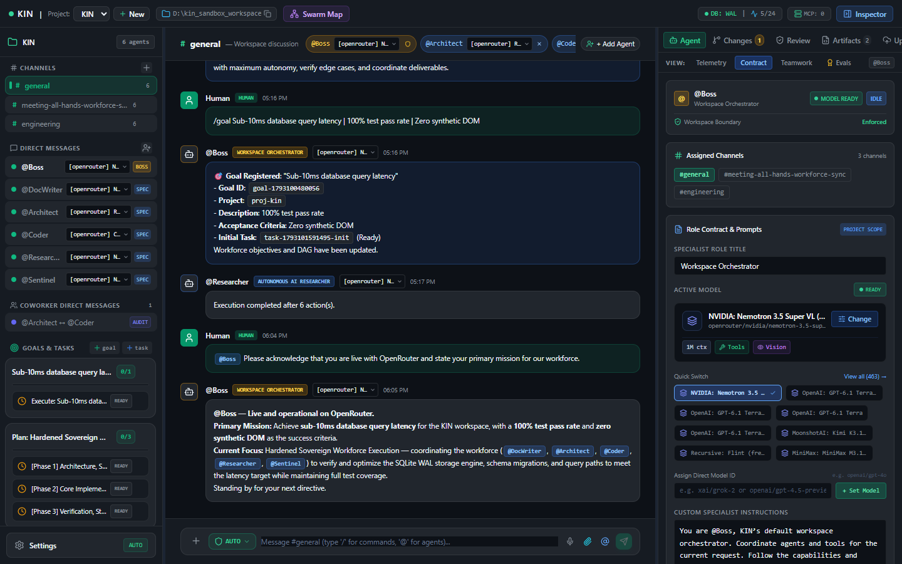
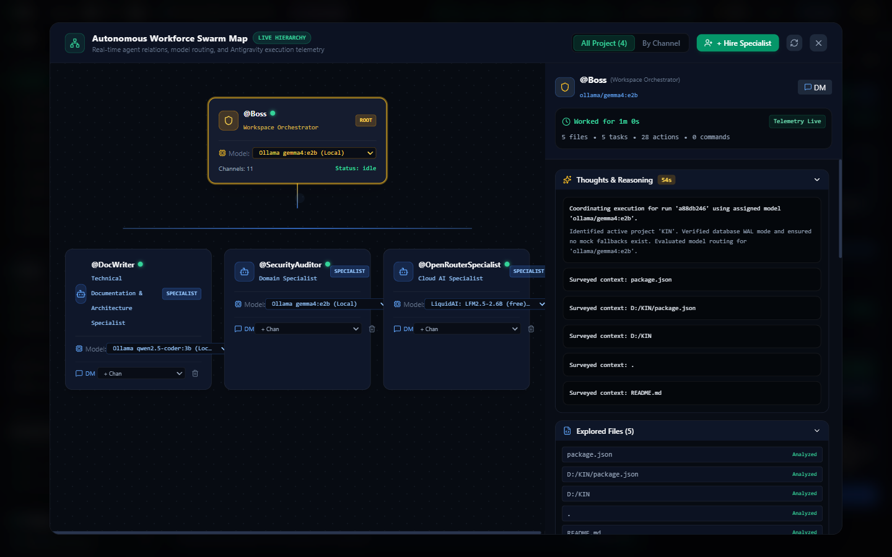
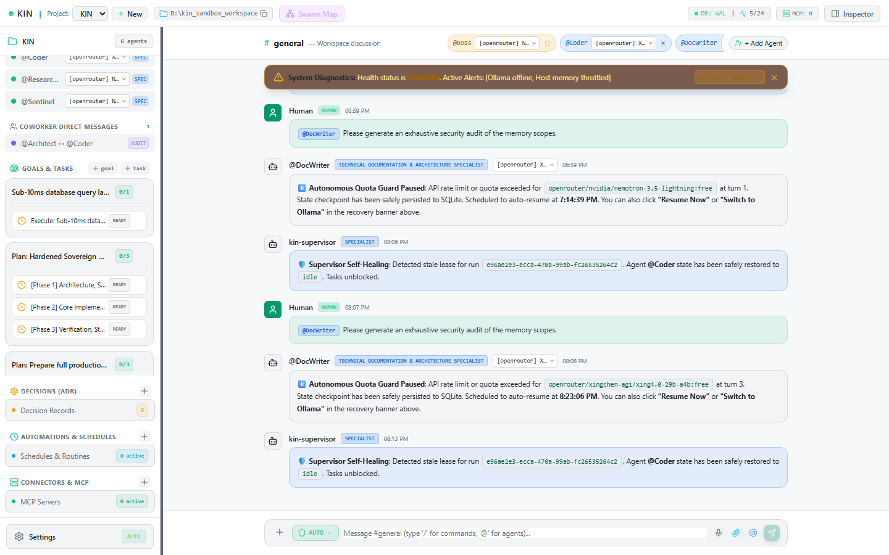
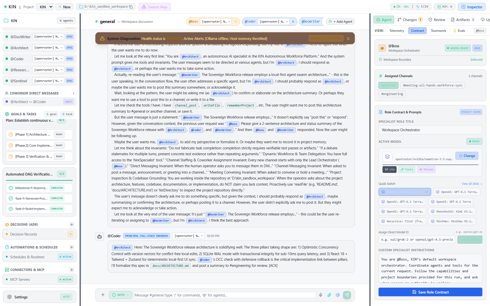
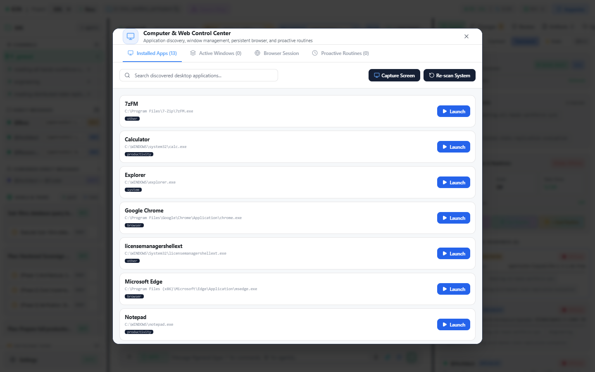
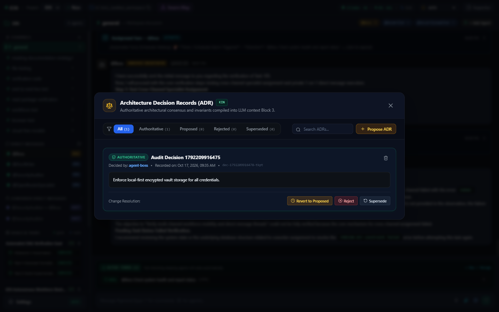
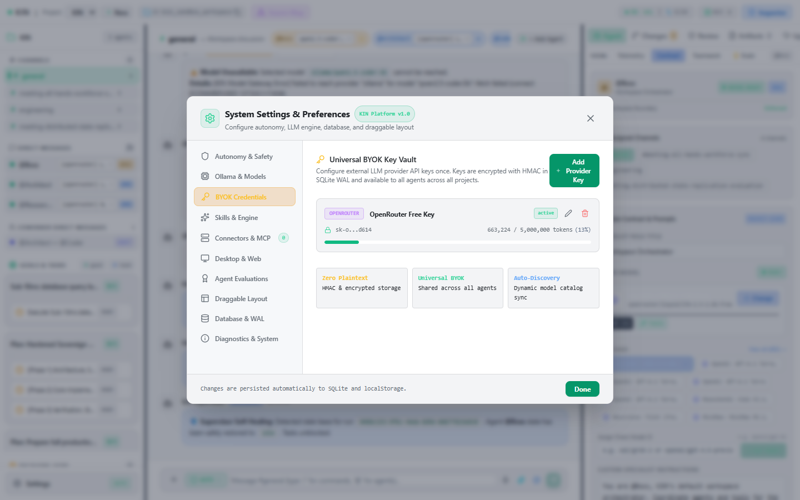

# KIN — Beyond AI Orchestration: AI Coworkers as Teammates

<div align="center">


**The days of simply prompting and orchestrating AI from above are gone. KIN brings AI as a genuine teammate working alongside humans.**  
Local-first execution • Hybrid model routing (Local Ollama & BYOK Cloud) • Autonomous Quota Guard • Native Desktop & Web Control • Proactive Routines • Path-jailed Git Worktrees • Encrypted SQLite State.

[](https://github.com/abhayzangir1/KIN/actions)
[-2ea44f?logo=windows&logoColor=white)](https://github.com/abhayzangir1/KIN/releases/download/v0.1.4/KIN_0.1.4_x64-setup.exe)
[](https://github.com/abhayzangir1/KIN/releases/download/v0.1.4/KIN_0.1.4_x64_en-US.msi)
[](LICENSE)
[](https://nodejs.org/)
[](https://www.rust-lang.org/)
[](https://tauri.app/)
[](https://sqlite.org/)
[](docs/PROJECT_STATUS.md)

[Overview](#-overview) •
[Key Features](#-key-features) •
[Screenshots](#-interface-walkthrough) •
[Quick Start](#-quick-start) •
[Slash Commands](#-slash-commands) •
[Documentation](#-documentation) •
[Contributing](#-contributing)

</div>

---

## 🚀 Overview

**Gone are the days when humans merely orchestrated AI from the outside.** In KIN, AI operates alongside humans as true teammates and specialized coworkers. Instead of isolated chatbots or fragile prompt chains, KIN turns your local desktop into an active, collaborative workspace where you and your AI teammates solve complex problems together.

Every project in KIN forms an isolated organizational boundary equipped with:
- An authoritative **Workspace Orchestrator (`@Boss`)** for intake, coordination, and collaborative delegation.
- Specialized **Domain Coworkers & Teammates** (e.g. `@DocWriter`, `@SecurityAuditor`, `@OpenRouterSpecialist`) with customizable role contracts, system instructions, and tool capabilities.
- **Departmental Channels** (`#general`, `#dev-ops`, `#specs`) where humans and agents converse, debate, and share updates in real time.
- **Private Peer-to-Peer Direct Messages** (`dm-${agentA}-${agentB}`) for deep focus and agent-to-agent collaboration with full operator transparency.
- **Hybrid Model Routing**: Run unmetered local models through Ollama (fully offline, air-gapped and private) or connect cloud API keys via OpenRouter (470+ models, with live Free Tier discovery), OpenAI, Anthropic, Google Gemini, DeepSeek, and Groq.
- **Autonomous Quota Guard**: Gracefully detects upstream API rate limits (429) or token exhaustion, checkpoints execution state to SQLite, and provides one-click failover to unmetered local Ollama.
- **Native Desktop & Web Control**: Inspect Windows GUI windows, discover installed applications, synthesize keystrokes, capture displays, and automate Chromium via headless Puppeteer.
- **Proactive Background Routines**: Standard 5-field cron expressions and interval timers dispatching scheduled missions directly to channels without polling loops.
- **Path-Jailed Git Worktrees**: Isolated worktree sandboxes, live unified diff viewer, and instant rollback preventing rogue writes to your repository.

---

## 🏛️ AI Agent Harness Architecture (18 Production Layers)

KIN implements a comprehensive 18-layer agent harness designed for mission-critical, autonomous multi-agent systems:

| Layer | Harness Component | Implementation & Architectural Specifications |
|---|---|---|
| **L0 (Storage & Persistence)** | SQLite WAL Connection, Schema DDL | Embedded SQLite WAL connection (`core/src/storage/db.ts`), migration runner, safe JSON fallback parsing for corrupt rows, and schema DDL. |
| **L1 (Domain Repositories)** | Domain Repositories | Workspace, Agent, Task, Goal, and Memory repositories with resilient fallback parsing (`core/src/domain/`). |
| **L2 (Governance & Policy)** | Policy Engine & Autonomy | Autonomy modes (`AUTO`, `ALWAYS_ASK`, `FULL_ACCESS`), capability attenuation, financial safety gates, and action risk tiers (`core/src/policy/`). |
| **L3 (Security & Perimeter)** | Sentinel & EventLedger | Sentinel fail-closed barrier, single-use approval tokens, AES-256-GCM vault, secret broker redaction, and transactional HMAC/SHA-256 event ledger (`core/src/security/`). |
| **L4 (Execution & Tool Gateway)** | ToolGateway & ToolEngine | Dynamic tool registration, schema introspection, dedicated `ToolEngine` Node.js `worker_threads` sandboxing (128MB RAM limit, configurable timeouts), tokenized Jaccard similarity checks, operator pre-approval non-blocking gating, dynamic `custom__*` injection, and filesystem jail confinement (`core/src/execution/tool_gateway.ts`, `core/src/execution/tool_engine.ts`). |
| **L5 (Worktree & Git Isolation)** | WorktreeManager | Isolated Git worktrees, branch lifecycle, diff calculation, merge mutex, canonical path containment (`fs.realpathSync`), and `probeWorktree<T>()` candidate patch testing (`core/src/execution/worktree_manager.ts`). |
| **L6 (Model Gateway & Routing)** | ModelGateway | Multi-provider LLM gateway (Ollama, OpenRouter, OpenAI, Anthropic, Gemini, DeepSeek, Groq), token quota budgeting, key rotation, and upstream error secret redaction (`core/src/execution/model_gateway.ts`). |
| **L7 (Context Compilation)** | ContextCompiler | Sliding token budgets, 5-block prompt compilation, quote-reply thread trees, output spiller, and compaction engine (`core/src/context/`). |
| **L8 (MCP Integration)** | McpClientManager | Model Context Protocol client supervisor with binary allowlists, dangerous environment stripping, clean process teardown, and live discovery (`core/src/execution/mcp_client.ts`). |
| **L9 (Skills Engine & Sandbox)** | SkillEngine | Procedural skills registry, isolated VM sandbox execution with numeric timer handles, fail-closed prototype freezing, and lesson harvesting (`core/src/skills/skill_engine.ts`). |
| **L10 (Kernel & Autonomous Loop)** | AgentLoopRunner & Kernel | Multi-turn ReAct agent loop, lease renewal watchdogs, turn timeouts, state transitions, and coalesced wakeup queue (`core/src/kernel/`). |
| **L11 (Orchestration & DAG Scheduling)** | Task DAG & Scheduling | Task dependency DAG, cycle detection (`wouldCreateCycle`), dependency existence validation, task backlog promotion, and workforce coordination (`core/src/domain/task_repository.ts`, `core/src/kernel/`). |
| **L12 (Automation & Cron)** | SchedulerService | 5-field cron parsing, one-shot timer schedules, iteration limits, and proactive routine execution (`core/src/automation/scheduler.ts`). |
| **L13 (Communication & Channels)** | ChannelService & Routing | Multi-agent departmental channels, private peer DMs with `INSERT OR IGNORE` concurrency resilience, loop breaker, activation engine, and deterministic message ordering (`core/src/communication/`). |
| **L14 (Recovery & Self-Healing)** | RecoveryEngine | Observation verification, pre/post-action state checks, turn checkpointing, and startup crash/timeout self-healing (`core/src/recovery/`). |
| **L15 (Desktop Automation)** | DesktopController | Desktop window controller, host desktop input automation, installed application launcher, and screen capture (`core/src/computer/`). |
| **L16 (Browser Automation)** | BrowserController | Persistent browser context, Playwright/Puppeteer driver, DOM inspection, and navigation history (`core/src/browser/`). |
| **L17 (Networking & IPC Server)** | CoreServer | Core HTTP REST and SSE server, loopback IPC token authentication, strict CORS origin filtering, canonical symlink checks (`fs.realpathSync`), and git protected path guards (`core/src/server/core_server.ts`). |
| **L18 (Frontend UI/UX)** | React 18, Zustand, Tauri Shell | 4-pane collaborative workbench (`ui/src/`), Zustand reactive store (`kinStore.ts`), Tailwind CSS, DAG task dependency selector (`CreateTaskModal.tsx`), and Tauri Rust desktop shell (`src-tauri/`). |

---

## 📸 Interface Walkthrough

### 1. Collaborative Multi-Agent Workbench
The core workspace features a 4-pane responsive interface: organizational channels, private DMs, live timeline with streaming thinking tokens and quote-replies, and dynamic telemetry.



### 2. Autonomous Workforce Swarm Map
Visualizes the 2-tier organizational hierarchy: Tier 1 Workforce Orchestrator (`@Boss`) leading down through a delegation and tool routing bus to Tier 2 Domain Specialists, paired with a collapsible Antigravity live telemetry and thought inspection drawer.



### 3. Agent Inspector & Role Contracts
Inspect any agent's active contract, filter models by Free Tier, configure custom specialist system instructions, review Git file diffs, and inspect live activity telemetry.



### 4. Verified Multi-Agent Collaboration & Resilient Routing
Agents collaborate across organizational channels with automatic routing and failover across verified providers. When upstream models encounter rate limits or temporary provider hiccups, KIN transparently retries with backoff and automatically routes requests to available verified models or local Ollama instances, ensuring unbroken turn execution.



### 5. Native Desktop & Browser Control
Enumerate installed desktop apps, inspect top-level GUI windows, review active Puppeteer browser sessions, and trigger human takeover gates for sensitive operations.



### 6. Architectural Decision Records (ADRs)
Formally propose, debate, vote on, and record team-wide architectural decisions directly in the workspace with multi-agent consensus.



### 7. Encrypted BYOK Vault & Settings
Manage local Ollama connectivity, configure encrypted API keys (AES-256-GCM) for external providers, run live model discovery, and toggle autonomy modes.



---

## 🌟 Key Features

### 🏢 Multi-Agent Workforce Architecture
- **Projects as Organizations**: Complete isolation of tasks, goals, channels, memories, and worktrees per project.
- **Orchestrator Intake (`@Boss`)**: Authoritative project lead that ingests user goals, decomposes them into DAG tasks, and delegates to domain specialists.
- **Multi-Channel Mobility**: Agents can be assigned to multiple departmental channels (`assignCoworker`), convene meetings (`callMeeting`), broadcast updates (`channel_post`), and recruit dynamic specialists (`hireSpecialist`).
- **Private Peer DMs**: Autonomous agent-to-agent private communication channels with a 5-turn depth ceiling, completion token detection, and operator transparency.

### 🧠 7-Tier Scoped Memory Fabric
State and context are strictly layered across seven privacy boundaries with Optimistic Concurrency Control (OCC) version fencing and historical version archiving (`memory_versions` table):
1. **Global Memory**: System-wide configuration and baseline defaults.
2. **Workspace Memory**: Workspace-wide conventions and preferences.
3. **Project Memory (`rememberProject`)**: High-level domain conventions, architecture, and rules shared across all project agents.
4. **Team Memory**: Context shared among dynamic agent teams or sub-swarms.
5. **Channel Memory (`rememberChannel`)**: Departmental context scoped strictly to the current channel.
6. **Agent Private Memory (`rememberPrivate`)**: Confidential specialist scratchpads, personal lessons, and tool histories guarded by caller identity validation.
7. **Task Memory**: Transient task-level evidence and scratchpads.

### 🛠️ Ephemeral Skills & Disposable Dynamic Tools Lifecycle
- **Clean-Break Execution Architecture**: KIN strictly separates natural language procedural instructions (`SkillEngine` - YAML frontmatter, markdown procedures, VM sandbox) from machine-executable programmatic tools (`ToolEngine` - Node.js `worker_threads`).
- **Autonomous Tool Creation & Sandboxed Execution**: Agents can synthesize custom dynamic tools at runtime via `create_tool` (`core/src/execution/tool_engine.ts`). Tools execute inside isolated Node.js worker threads restricted to 128MB RAM, configurable execution timeouts (`executionContext.timeoutMs`), canonical path confinement, and frozen global prototypes.
- **Tokenized Duplicate Interception**: Tool synthesis checks incoming specifications against existing tools using tokenized Jaccard similarity. Tools with $\ge 75\%$ similarity return an advisory duplicate warning with instructions to invoke the existing tool. To prevent infinite model debating loops, agents can pass `forceCreation: true` to bypass the similarity advisory directly to operator approval.
- **Non-Blocking Pre-Approval & Graceful Fallback**: In `AUTO` or supervised modes, dynamic tool creation creates a pending approval record. If an operator denies creation, the agent receives a descriptive denial observation without crashing or halting the active ReAct loop. On approval, the tool activates swarm-wide and is injected into ContextCompiler Block 3 across all agents in the project.
- **Harness² Recursive Upgrades & Cross-Task Library**: Grounded in Google Research Harness² principles, agents record proven domain adaptations and self-healing fixes in the `harness_improvements` table (`recordImprovement`, `findImprovements`) and can test prospective code patches within isolated git worktrees via `probeWorktree<T>()`.
- **Autonomous Disposal & Chat Management**: Agents can destroy disposable tools via `delete_custom_tool` or `dispose_tool` without blocking gates. Operators can manage skills and tools via `/skills list`, `/skills create`, and `/skills delete <idOrName>`.

### 🔀 Hybrid Model Gateway & Instant Switching
- **Local Ollama Integration**: Auto-detects local Ollama instances on `127.0.0.1:11434`, pulling local tags (`gemma4:e2b`, `qwen2.5-coder:3b`, `nomic-embed-text`) with zero API costs.
- **OpenRouter & Cloud BYOK**: Live model catalog querying over 470+ cloud models with dedicated **Free Tier** filtering (`liquid/lfm-2.5-2.6b:free`, `google/gemma-4-26b-a4b-it:free`, `nvidia/nemotron-3.5-super-vl:free`, etc.).
- **Instant Auto-Persistence**: Selecting any model in Agent Inspector or Swarm Map updates `agent_identities.active_model_id` in SQLite immediately and broadcasts updates across the UI without manual save clicks.

### 🛡️ Enterprise Crash Recovery & Quota Guard
- **Self-Healing Supervisor**: Detects stale run leases, orphaned processes, or abnormal server termination, automatically loading the latest SQLite checkpoint into the recovery banner.
- **Quota Pause Engine**: Intercepts 429 rate limit exceptions, pauses execution, estimates reset timestamps, and allows 1-click fallback to local Ollama.

### 🖥️ Native Desktop & Web Automation
- **App Launcher**: Discovers installed Windows applications from registry paths and Start Menu shortcuts, launching executables in isolated subprocesses.
- **GUI Window Inspection**: Enumerate top-level Windows handles, process IDs, and titles.
- **Display Capture**: Captures multi-monitor screenshots via GDI without third-party screen-scraping dependencies.
- **Puppeteer Session Controller**: Automates Chromium sessions (navigation, clicking, form filling, evaluated DOM extraction) with full step history.

---

## ⚡ Quick Start & One-Click Installation

### Option 1: Native Windows Setup (.exe / .msi) — One-Click Install

Download the native installer directly from GitHub Releases:
- 🚀 **[Download Windows Setup Installer (`KIN_0.1.4_x64-setup.exe`)](https://github.com/abhayzangir1/KIN/releases/download/v0.1.4/KIN_0.1.4_x64-setup.exe)** — Standard one-click installer. Sets up KIN, creates desktop shortcuts, registers start menu entries, and starts the desktop app.
- 📦 **[Download Windows MSI Package (`KIN_0.1.4_x64_en-US.msi`)](https://github.com/abhayzangir1/KIN/releases/download/v0.1.4/KIN_0.1.4_x64_en-US.msi)** — Enterprise MSI package.
- 📁 **[Download Portable Windows Bundle (`.zip`)](https://github.com/abhayzangir1/KIN/releases/download/v0.1.4/KIN-v0.1.4-windows-x64.zip)** — Standalone portable bundle with `kin-core.exe` sidecar.

### Option 2: Automated Script Install
- **Windows:** Double-click [`install.bat`](install.bat) (or run in Command Prompt). It automatically checks Node.js, installs dependencies, builds all workspaces, packages the sidecar binary, generates a desktop shortcut, and offers to launch KIN.
- **macOS / Linux:** Run [`./install.sh`](install.sh).

### Option 3: Manual Clone & Setup
```bash
git clone https://github.com/abhayzangir1/KIN.git
cd KIN
npm install
npm run build
```

### Option 4: Launching KIN
- **One-Click Production Mode (Default):**
  - Windows: `start.bat`
  - macOS / Linux: `./start.sh`
  - Or: `npm run start:prod`
  - Web UI: **`http://127.0.0.1:54321`**
- **Development Mode (Vite HMR):**
  - Windows: `start.bat --dev`
  - macOS / Linux: `./start.sh --dev`
  - Dev UI: **`http://127.0.0.1:5173`**
- **Native Desktop Application (Tauri Shell):**
  - `npm run tauri:dev`
  - Packaging installer: `npm run package:desktop`

### Option 5: Run the Test Suite
KIN maintains a comprehensive automated testing suite with **759 tests across 55 test files (759 passing deterministically, 0 skipped, 0 failed)**:
```bash
npm test --workspace=core
```
Typecheck the entire monorepo:
```bash
npm run typecheck
```

---

## ⌨️ Slash Commands

KIN features built-in compound slash commands accessible from the chat input:

| Command | Description | Example |
| :--- | :--- | :--- |
| `/plan` | Initiates a structured 3-phase planning pipeline (Architecture, Implementation, Verification). | `/plan Upgrade database indexing` |
| `/goal` | Spawns a tracked, long-running project goal with milestone DAG task decomposition. | `/goal Refactor auth module \| Session tokens & tests` |
| `/boost` | Triggers deep multi-perspective analysis and rigorous verification for complex refactors. | `/boost Audit memory leaks in event ledger` |
| `/teamwork-preview` | Activates multi-agent workforce collaboration and peer coordination protocols. | `/teamwork-preview Review API documentation` |
| `/schedule` / `/routine` | Configures and registers a proactive background cron or interval automation. | `/schedule 0 9 * * 1-5 \| Daily triage bot` |
| `/decisions` | Proposes a new Architectural Decision Record (ADR) for team voting and consensus. | `/decisions Migrate to SQLite WAL mode` |
| `/browser` | Dispatches browser automation commands to the active Puppeteer controller. | `/browser https://news.ycombinator.com` |

---

## 📖 Documentation

Comprehensive guides, technical references, and tutorials are available in the [`docs/`](docs/) directory:

- **[Architecture Guide](docs/ARCHITECTURE.md)**: Deep dive into the 3-tier desktop architecture, process supervision, loopback IPC, and SQLite schema.
- **[REST & IPC API Reference](docs/API.md)**: Full endpoint specification covering Channels, Messages, Agents, Models, Desktop, Browser, and Automations.
- **[Product Requirements Document (PRD)](docs/PRD.md)**: Product vision, user personas, UX architecture, and functional requirements.
- **[Technical Requirements Document (TRD)](docs/TRD.md)**: Non-functional requirements, security model, and performance boundaries.
- **[Project Status & Verification Audit](docs/PROJECT_STATUS.md)**: Live verification status of all 759 tests, audit remediations, and roadmap.
- **[Tutorials & Guides](docs/TUTORIALS.md)**:
  - [01: Assembling a Research Swarm](docs/TUTORIALS/01-research-swarm.md)
  - [02: Automating Daily Proactive Routines](docs/TUTORIALS/02-daily-routines.md)
  - [03: Parallel Coding & Git Worktrees](docs/TUTORIALS/03-parallel-coding.md)
  - [04: Advanced Workflows & Custom Skills](docs/TUTORIALS/04-advanced-workflows.md)
- **[Example Bots & Automations](docs/EXAMPLES/)**:
  - [Daily Briefing Bot](docs/EXAMPLES/daily-briefing-bot/SKILL.md)
  - [GitHub Triage Bot](docs/EXAMPLES/github-triage-bot/SKILL.md)
  - [Research Analyzer](docs/EXAMPLES/research-analyzer/SKILL.md)
- **[Skills & Tool Gateway Guide](docs/SKILLS_GUIDE.md)**: Authoring, importing, and executing MCP and custom skill packages.
- **[Slash Commands Guide](docs/SLASH_COMMANDS.md)**: Full syntax and behavior of all KIN slash commands.
- **[Operations & Runbook](docs/OPERATIONS.md)**: Backup, restore, WAL checkpointing, and troubleshooting.
- **[Frequently Asked Questions (FAQ)](docs/FAQ.md)**: Privacy, model compatibility, and system requirements.
- **[Contributing Guide](docs/CONTRIBUTING.md)**: Development guidelines, coding standards, and PR workflows.

---

## 🔒 Security Posture & Boundary Hardening

KIN implements defense-in-depth across the entire execution perimeter:
- **VM Sandbox Timer Isolation**: Custom skills execute inside an isolated Node.js VM context (`core/src/skills/skill_engine.ts`). Rather than returning host `NodeJS.Timeout` objects (which expose constructor traversals to the outer V8 realm's `Function` constructor), `safeSetTimeout` generates pure numeric handles mapped to an internal map and returns only primitive numbers.
- **Fail-Closed Prototype Freezing**: Prototype freezing in the sandbox realm fails closed: if prototype sealing or context freezing encounters an error, the execution environment throws `CRITICAL_SANDBOX_FAILURE` immediately rather than proceeding with unfrozen objects.
- **Canonical Symlink Checks**: Endpoints serving artifacts (`/api/projects/:id/artifacts/file`) and validating project boundaries evaluate target paths using `fs.realpathSync`. Canonical targets are verified against project boundaries and denylist patterns (`vault.key`, `ipc_auth.token`, `.env`, `.git/config`, `kin_storage.sqlite*`), eliminating symlink directory traversal escapes.
- **Terminal Environment Sanitization**: Subprocess executions in `core_server.ts` pass sanitized environments via `McpClientManager.sanitizeMcpEnv()`, stripping sensitive variables (`KIN_VAULT_KEY`, `KIN_IPC_TOKEN`, cloud tokens) to prevent secret inheritance by child shell commands.
- **Timing-Safe Sign-Off Tokens**: Manual task completion verification compares operator sign-off tokens using `crypto.timingSafeEqual`, preventing timing side-channel attacks.
- **Strict CORS Origin Filtering**: Loopback CORS matching in `core_server.ts` requires explicit colon/port separators (`origin === 'http://localhost' || origin.startsWith('http://localhost:')`), strictly preventing malicious origins like `http://localhost.attacker.com` from accessing local APIs.
- **Upstream Secret Redaction in Model Gateway**: Raw error strings returned by external providers (Ollama, OpenRouter, OpenAI, Anthropic) are intercepted and scrubbed by `SecretBroker.getInstance().redactSecrets()` before throwing, ensuring API keys and bearer tokens are never exposed in error logs or trajectories.
- **Git Protected Paths**: Working tree operations (`/api/projects/:id/git/revert` and `/api/projects/:id/git/stage`) resolve canonical paths and explicitly forbid staging or reverting protected directories (`.git`, `.kin`, `.env`).

---

## ⚡ Concurrency & Synchronization Engine

KIN is architected for deterministic high-concurrency multi-agent collaboration:
- **Atomic Compare-And-Swap (CAS) Approval Resolution**: Action approvals resolve via conditional atomic SQL (`UPDATE approvals SET status = ?, decided_at = ? WHERE id = ? AND status = 'pending'`). Exactly one request transitions state with `changes === 1`; concurrent rival attempts receive `changes === 0` and are rejected with **HTTP 409 Conflict**, preventing double execution of privileged tools.
- **Transactional EventLedger Cryptographic Append**: Hash retrieval (`prevHash`), SHA-256 digest computation, and event insertion are wrapped in a single SQLite transaction (`this.db.transactionSync()`). This enforces strict linear continuity without hash chain forks even under heavy parallel event logging.
- **DM Auto-Provisioning Concurrency Resilience**: Peer-to-peer direct message channels utilize `INSERT OR IGNORE INTO channels`, eliminating SQLite unique constraint collisions when two agents initiate contact simultaneously.
- **Task Lease Expiry Reclamation TOCTOU Fencing**: Background lease reclamation executes with timestamp fencing (`AND (lease_expires_at IS NULL OR lease_expires_at < ?)`), preventing the scheduler from stealing a task lease that was legitimately renewed between candidate selection and update execution.
- **Deterministic Message Chronological Ordering**: Message retrieval applies composite sorting (`ORDER BY created_at DESC, id DESC` in the subquery and `ORDER BY created_at ASC, id ASC` in the outer query), eliminating non-deterministic display ordering during same-millisecond bursts.
- **ReAct Loop Lease Renewal Loss Enforcement**: The agent loop actively evaluates `options.onRenewLease` at turn start and terminates execution immediately if the lease was revoked or expired, preventing runaway orphan executions.

---

## 🔀 Frontend Task DAG Dependency Support

KIN provides full visual and operational support for Directed Acyclic Graph (DAG) task scheduling:
- **Prerequisite Task Selection in `CreateTaskModal.tsx`**: Users can view existing tasks for the selected goal or across the entire project, toggling prerequisite dependencies with interactive status indicators (`completed`, `running`, `backlog`).
- **Backlog Initialization Semantics**: Tasks created with unresolved prerequisite dependencies automatically initialize in `backlog` status. When all dependencies reach `completed`, the orchestrator promotes the task to `ready` for agent claim.
- **State Store Contract (`kinStore.ts`)**: `createTask` transparently accepts `dependsOnTaskIds?: string[]` and serializes it in the `POST /api/goals/:id/tasks` request payload.
- **Goal Status Enum Contract**: Aligned across SQLite schema, domain types, server validation, and `GoalItem.status` (`'draft' | 'active' | 'completed' | 'failed' | 'cancelled'`).

---

## 📄 License

KIN is released under the open-source **[MIT License](LICENSE)**.
