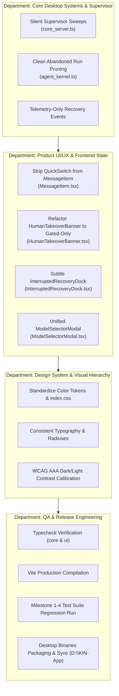

# KIN UI/UX Architectural Audit & Remediation Report

**Date**: November 11, 2026  
**Auditor**: Multi-Agent Architectural & UX Engineering Swarm  
**Scope**: User Experience (UX), Notification & Alert Clutter, Visual Hierarchy, Design Rules, Model Assignment Architecture, and Concurrency Cleanup  

---

## Executive Summary

While the KIN desktop application is fully operational and functionally complete across Milestones 1–4, user experience testing has revealed critical usability degradation in daily usage:
1. **Severe Notification & Operational Alert Pollution**: The supervisor watchdog's internal lease-sweeping logic routinely broadcasts false-alarm messages into user chat channels (`🛡️ **Supervisor Self-Healing**: Detected stale lease... Auto-aborted stalled run`), causing confusion and giving the false impression of system instability.
2. **Intrusive Operational Banner Stacking**: Multiple heavy operational docks—`HumanTakeoverBanner`, `InterruptedRecoveryDock`, `QuotaPauseBanner`, and machine control headers—render concurrently above the chat timeline, consuming up to 50% of the vertical viewport and displaying alarming `ABORT`, `PAUSE`, `HEALING` states during ordinary execution turns.
3. **Clunky & Redundant Model Selection**: Model selection is scattered across four disparate surfaces, including a dropdown inside *every individual message bubble in chat history*. The central `ModelSelectorModal` suffers from cognitive overload with redundant channel-level selector overrides.
4. **Visual Hierarchy & Color Inconsistency**: The design system suffers from clashing arbitrary hex codes, high-saturation alert surfaces, mismatched button corner radiuses, and aggressive `!important` sledgehammers in `index.css` that interfere with light/dark contrast standards.

This report specifies the architectural root causes, visual standards, and exact remediation plan to bring KIN to world-class desktop UI/UX standards.

---

## 1. Forensic Audit & Root Cause Analysis

### 1.1 Chat Pollution from Internal Supervisor Self-Healing
- **Location**: `core/src/server/core_server.ts:938-961` (`runSupervisorSelfHealing`)
- **Mechanism**: Every 15 seconds, `startSupervisorWatchdog` calls `runSupervisorSelfHealing()`. If any background run from prior sessions or tests has an expired lease (>45s heartbeat), the supervisor executes `this.channelService.sendMessage(...)` with message content:
  ```markdown
  🛡️ **Supervisor Self-Healing**: Detected stale lease for run `<runId>`. Agent **<Name>** state has been safely restored to `idle`. Tasks unblocked.
  ```
- **Impact**: These messages are rendered in the user's primary channel as high-prominence cards (`isSlashCard` in `MessageItem.tsx:147`), terrifying users into believing runs are continually crashing and self-healing.
- **Architectural Remedy**:
  - Relegate supervisor watchdog lease reclamation strictly to server diagnostics (`console.log`) and Swarm Map telemetry events (`broadcastEvent('system:recovered')`).
  - **Zero chat messages** generated for routine internal lease sweeps.

### 1.2 "Interrupted Run Recovery" Amber Dock Inundation
- **Location**: `ui/src/components/banners/InterruptedRecoveryDock.tsx`, `core/src/server/core_server.ts:885-905`
- **Mechanism**: Every recovered stale lease pushes an item into `pendingRecoveries` and broadcasts `system:recovery-state`. The frontend `kinStore.ts` stores this in state, mounting `InterruptedRecoveryDock` at the top of `CenterView.tsx`.
- **Impact**: A massive amber container with `Resume All`, `Discard All`, `Inspect State`, `Switch & Resume` remains persistently anchored to the viewport even when the run was just an idle test run or startup sweep with no actual user turn to resume.
- **Architectural Remedy**:
  - Only genuine interactive runs with valid turn checkpoints (`checkpoint.snapshotJson` and active user query) should ever be presented as recoverable.
  - Abandoned / lease-expired runs without interactive turn checkpoints are cleanly retired to `cancelled` state without bothering the user.
  - When recoverable runs do exist, provide a subtle, dismissible top banner that collapses cleanly instead of dominating the view.

### 1.3 Intrusive `HumanTakeoverBanner` Default State
- **Location**: `ui/src/components/banners/HumanTakeoverBanner.tsx:51-55`
- **Mechanism**: The banner renders whenever `isChannelExecuting` is true—i.e., *every time any agent is generating a response*. It displays high-contrast alert boxes with `EXECUTING`, `Pause (Esc)`, `Abort`, `Steer`.
- **Impact**: Normal conversation turns feel like an emergency incident response procedure.
- **Architectural Remedy**:
  - `HumanTakeoverBanner` should ONLY appear when:
    1. A human takeover is explicitly initiated (`activeTakeover.isPaused`),
    2. A hard human-in-the-loop gate is triggered (`authRequired`, `financialGate`, or explicit tool permission prompt).
  - During standard execution, a clean, tranquil inline status indicator in the input area (`Agent is thinking...`) is displayed without jarring modal bars.

### 1.4 Model Assignment Clutter & Redundancy
- **Locations**:
  - `ui/src/components/messages/MessageItem.tsx:297-306` (`AgentModelQuickSwitch` mounted on every message bubble).
  - `ui/src/components/Sidebar.tsx:250-257` (`AgentModelQuickSwitch` on every sidebar agent item).
  - `ui/src/components/ModelSelectorModal.tsx` (channel-scoped override complexity).
- **Problems**:
  - Showing a model dropdown on historical message bubbles in chat history violates fundamental UX rules (historical messages represent completed turns; changing a model on a message sent yesterday is meaningless and visually distracting).
  - The `ModelSelectorModal` includes redundant nested dropdowns for "Project" and "Channel: All Project Channels vs #channel", creating confusing state permutations.
- **Architectural Remedy**:
  - Remove `AgentModelQuickSwitch` completely from `MessageItem.tsx`. Chat messages focus 100% on dialogue content and clean metadata.
  - Simplify agent model assignment to a direct, elegant 1-click model card experience:
    - User clicks the agent in Sidebar or Agent Settings -> opens the unified `ModelSelectorModal`.
    - Modal displays active agent identity, current model, and clean provider tabs (Ollama, NVIDIA NIM, OpenAI, Anthropic, Gemini, Groq, OpenRouter).
    - Instant 1-click "Select Model" with clear visual active checkmark, eliminating channel dropdown confusion.

### 1.5 Visual Hierarchy & Design System Rules
- **Problem**: Inconsistent typography, varying border radiuses (`rounded`, `rounded-md`, `rounded-lg`, `rounded-xl`), arbitrary hex color classes, and aggressive CSS overrides with `!important` in `index.css`.
- **Architectural Remedy**:
  - Standardize on cohesive Design Tokens:
    - **Canvas**: Neutral dark `#0a0d14` / Light `#f8fafc`.
    - **Surface**: Subtle elevated `#111622` / Light `#ffffff`.
    - **Cards**: `#161e2e` / Light `#f1f5f9`.
    - **Borders**: `rgba(255, 255, 255, 0.08)` / Light `rgba(0, 0, 0, 0.08)`.
    - **Primary Accent**: Emerald `#10b981` (focused, deliberate, positive).
    - **Secondary Accent**: Sky `#38bdf8` (informative, agent identity).
    - **Muted Text**: `#94a3b8` (WCAG AAA compliant contrast).
  - Consistent component geometry: `rounded-xl` for containers/modals, `rounded-lg` for buttons/inputs, `rounded-md` for badges.
  - Unified button sizing and subtle hover transitions.

---

## 2. Multi-Agent Remediation Matrix



---

## 3. Implementation Plan & Execution Gates

1. **Gate 1: Core Daemon & Watchdog De-noising**
   - Eliminate `sendMessage` from `runSupervisorSelfHealing`.
   - Ensure heartbeat lease recoveries only emit `agent:state` and server logs.
   - Guard `pendingRecoveries` so only real runs with uncommitted turn checkpoints are flagged.

2. **Gate 2: Chat & Message Cleanup**
   - Remove `AgentModelQuickSwitch` from `MessageItem.tsx`.
   - Remove operational healing/abort badges from message cards.
   - Refactor `HumanTakeoverBanner` to mount only on true takeover (`isPaused`) or hard safety gates (`authRequired`, `financialGate`).

3. **Gate 3: Streamlined Model Assignment Architecture**
   - Refactor `ModelSelectorModal.tsx` to directly select models for the target agent.
   - Eliminate redundant project/channel dropdowns.
   - Provide clear provider tabs (Ollama, NVIDIA NIM, OpenAI, Anthropic, Gemini, Groq, OpenRouter), search filtering, and 1-click assignment.

4. **Gate 4: Visual Hierarchy & Design System Harmonization**
   - Clean up `ui/src/index.css` by establishing clean CSS variables and removing conflicting overrides.
   - Ensure crisp typography, consistent button radiuses (`rounded-lg`), and balanced color hierarchy.

5. **Gate 5: Verification, Packaging & Deployment**
   - Run `npm run typecheck` across the monorepo.
   - Run `npm run build` for UI assets.
   - Execute vitest test suites to ensure zero regression across 863+ unit and opaque-box tests.
   - Build desktop binaries and synchronize to `D:\KIN-App`.
