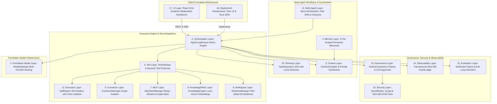
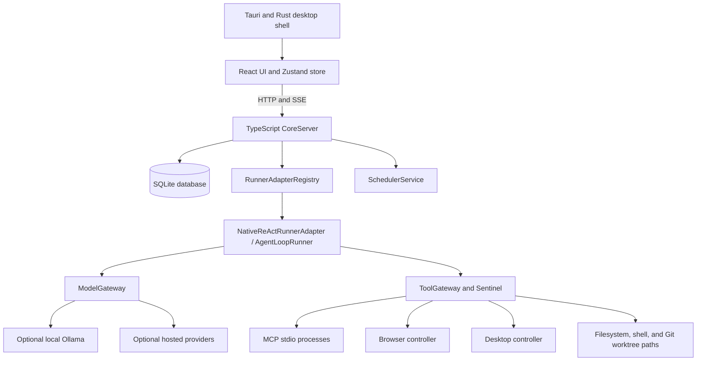

# KIN architecture

This document summarizes the architecture represented by the current source. It describes code boundaries, not an assurance that every subsystem is complete or verified in a packaged application. See [Current implementation notes](PROJECT_STATUS.md) for scope and limits. Product and technical requirements are maintained separately in [PRD](PRD.md) and [TRD](TRD.md).

## AI Agent Harness Architecture (18 Production Layers)

KIN organizes its agentic architecture into 18 discrete, production-hardened layers:



| Layer | Harness Component | File Path | Implementation & Guarantees |
|---|---|---|---|
| **1. Foundation Model Layer** | `ModelGateway` | `core/src/execution/model_gateway.ts` | Multi-provider routing (Ollama, OpenRouter, OpenAI, Anthropic, Gemini, DeepSeek, Groq), multi-key pooling, streaming SSE, and secret-redacted upstream error interception. |
| **2. Orchestration Layer** | `AgentLoopRunner`, `@Boss` | `core/src/kernel/agent_loop.ts` | ReAct autonomous reasoning-acting cycles, turn timeouts, loop breakers, mid-execution steering aborts, and lease loss watchdog enforcement. |
| **3. Context Layer** | `ContextCompiler` | `core/src/context/context_compiler.ts` | Sliding token budgets, prompt compilation, quote-reply thread trees, and system prompt dynamic synthesis. |
| **4. Memory Layer** | `MemoryRepository` | `core/src/domain/memory_repository.ts` | 4-tier scoped memories (Project, Channel, Agent-Private, and DM) with secret redaction and temporal retrieval. |
| **5. Tool Layer** | `ToolGateway` | `core/src/execution/tool_gateway.ts` | Dynamic tool registration, schema introspection, permission checking, and safe cancellation via AbortSignal. |
| **6. Connector Layer** | `ConnectorManager` | `core/src/execution/connector_manager.ts` | Custom integration adapters with strict project/global scope boundaries and sanitized process environments. |
| **7. MCP Layer** | `McpClientManager` | `core/src/execution/mcp_client.ts` | Model Context Protocol client supervisor with binary allowlists, dangerous env stripping, clean process teardown, and live discovery. |
| **8. Knowledge/RAG Layer** | `KnowledgeEngine` | `core/src/knowledge/` | Local vector and text embeddings (`nomic-embed-text`), similarity search, and workspace document indexing. |
| **9. Workspace Layer** | `WorktreeManager` | `core/src/worktree/` | Isolated Git worktrees, canonical path-jailing (`fs.realpathSync`), unified diff generation, and transactional rollbacks. |
| **10. Planning Layer** | `TaskRepository` | `core/src/domain/task_repository.ts` | DAG task planning, cycle detection (`wouldCreateCycle`), dependency existence validation, and status transitions. |
| **11. Execution Layer** | `SkillEngine` | `core/src/skills/skill_engine.ts` | Sandboxed VM execution with prototype freezing fail-closed, timer isolation (opaque IDs), and host reference eradication. |
| **12. Multi-Agent Layer** | `AgentRepository`, `ChannelService` | `core/src/domain/`, `core/src/communication/` | Multi-agent workforce coordination, departmental channels, peer-to-peer DMs with concurrency resilience (`INSERT OR IGNORE`), and deterministic chronological ordering. |
| **13. Governance Layer** | `Sentinel`, Autonomy Modes | `core/src/security/sentinel.ts` | Strict autonomy policies (`AUTO`, `SUPERVISED`, `READ_ONLY`), atomic CAS approval gates (`409 Conflict`), and lease ownership fencing. |
| **14. Observability Layer** | `EventLedger`, Telemetry Drawer | `core/src/security/event_ledger.ts` | Transactional SHA-256 cryptographic hash-chained event journal, live thought streaming, and action audit records. |
| **15. Evaluation Layer** | `EvaluationHarness` | `core/src/evaluation/` | Verification specs, test runners, output validation gates, and anti-loop stagnation heuristics. |
| **16. Security Layer** | `SecretBroker`, `Vault` | `core/src/security/secret_vault.ts` | Scrypt KDF, AES-256-GCM credential vault, constant-time token comparison (`timingSafeEqual`), loopback port bounds, and protected path guards. |
| **17. UI Layer** | React 18, Tailwind, Zustand | `ui/src/` | 4-pane collaborative workbench, 2-tier swarm map, DAG task dependency selector, and calm dark mode. |
| **18. Deployment Infrastructure** | Tauri v2, Rust Shell, Node.js Core | `src-tauri/`, `core/src/server/` | Local-first desktop packaging, supervised loopback daemon, and single-port authenticated REST/SSE IPC. |

---

## Runtime overview



## Components

### Desktop and interface

`src-tauri/` contains the Tauri application, Rust startup/supervision code, and platform-specific desktop integration. `ui/` contains the React interface and Zustand store. The UI communicates with the TypeScript core over local HTTP and Server-Sent Events; Tauri packaging and browser-based development are distinct launch modes.

### Core service and persistence

`core/src/server/core_server.ts` constructs and connects the runtime services, starts the local HTTP server, and exposes API routes and SSE events. The default listener uses `127.0.0.1:54321`; the daemon can select another port with `KIN_PORT`.

`core/src/storage/` initializes SQLite and migrations. Domain repositories manage projects, agents, tasks, goals, channels, and memory. The event ledger records structured events. Application state and project files are local by default, while integrations may make external requests.

### Agent execution and workforce runtime

KIN organizes agents within a project-scoped organization boundary. Every project maintains its own isolated Boss orchestrator (`agent-boss-${projectId}`) and specialist coworkers.

- `RunnerAdapter`: A pluggable interface and registry (`core/src/kernel/runner_adapter.ts`) decoupling execution engines from KIN's state and security authority. The default engine is `NativeReActRunnerAdapter`, wrapping `AgentLoopRunner`.
- `4-Tier Memory Scoping`:
  - **Tier 1 (Project-Shared Memory)**: Project goals, architectural decisions, and project memories accessible to all project coworkers.
  - **Tier 2 (Conversation-Scoped Context)**: Channel message trajectories and channel memories accessible to enrolled channel members.
  - **Tier 3 (Agent-Private Memory)**: Personal agent reflections, learned skills, and scratchpad state (`scope: 'agent_private'`).
  - **Tier 4 (Direct Message Privacy)**: Direct messages between the operator and an agent, or peer-to-peer between two coworker agents (`dm-${agentA}-${agentB}`), isolated strictly to participants.
- `Workforce Coordination`: Tools for `hireSpecialist`, `assignCoworker` (channel enrollment), `callMeeting` (convening departments with agendas), `sendDirectMessage`, `channel_post` (cross-channel announcements & decision record posting), and `delegateToAgent`.
- `Operator Inspection Mode`: The operator can monitor peer coworker direct messages in real time with live thought streaming and intervention controls.
- `ContextCompiler`: Gathers agent, project, task, channel, tiered memory, and skill context into deterministic prompt blocks.
- `WakeupQueue`: Coalesces pending wakeups in process memory; durable run and task state is stored separately.

Task leases coordinate claims in SQLite. The source includes checkpointing and startup recovery paths, but those mechanisms should not be read as exact replay or lossless recovery assurances.

### Models and credentials

`ModelGateway` handles provider model discovery and inference adapters, including Ollama and configured hosted providers. `SecretVault` and `SecretBroker` manage credentials and secret substitution/redaction paths. Model catalogs and configured-key status do not prove successful inference; the selected provider must accept a real request.

Hosted requests send the prompt and context supplied to that provider off-device. Ollama can run inference locally when available, but other application features may still use network connections.

### Tools and integrations

`ToolGateway` builds tool schemas and dispatches filesystem, shell, scheduling, browser, desktop, skill, and MCP calls. `Sentinel` evaluates tool authorization and approvals. Several direct HTTP control endpoints also exist, so a single gateway diagram should not be interpreted as proof that every privileged action shares one enforcement path.

MCP configuration is read from supported project configuration locations by `McpClientManager`. MCP servers run as child processes and can receive the tool arguments sent to them. Review server commands and configuration before enabling them.

The browser and desktop controllers use host capabilities. A tool approval or project path check is an application control rather than hardware-level process isolation. Chromium flags, host permissions, and platform behavior affect the actual boundary.

Git worktrees provide a separate working directory for supported coding tasks, serialized via an AsyncMutex lock. They do not isolate child processes, host credentials, or network access.

### Scheduling

`SchedulerService` stores one-shot and recurring schedules in SQLite. Recurring schedules use a five-field cron parser and next-occurrence calculator in `cron_calendar.ts`. The service records dispatch attempts and supports retry paths. Scheduler state does not ensure that a target model or downstream task will complete successfully.

## Data and trust boundaries

```text
Local UI / Tauri window
        │ local HTTP + SSE
        ▼
CoreServer ───── SQLite and local project files
   │
   ├── Ollama (local service, if configured)
   ├── Hosted model provider (prompt/context leave the machine)
   ├── Browser destination (network request to visited site)
   └── MCP process/service (receives tool arguments)
```

Treat model output, browser content, MCP responses, imported skills, project files, and user-provided prompts as untrusted input. Application-level approvals and capability checks reduce risk but should not be described as a host security boundary.

## Source map

| Area | Main path |
|---|---|
| HTTP/SSE API and service assembly | `core/src/server/core_server.ts` |
| Run state and execution loop | `core/src/kernel/agent_loop.ts` |
| Pluggable runner adapters | `core/src/kernel/runner_adapter.ts` |
| Context compiler and memory tiering | `core/src/context/context_compiler.ts` |
| Communication and activation | `core/src/communication/` |
| Domain persistence | `core/src/domain/` |
| SQLite schema and migrations | `core/src/storage/` |
| Model providers | `core/src/execution/model_gateway.ts` |
| Tools and MCP | `core/src/execution/` |
| Authorization and secrets | `core/src/security/` |
| Scheduler | `core/src/automation/` |
| Skills | `core/src/skills/` |
| UI state and components | `ui/src/` |
| Desktop shell | `src-tauri/src/` |
