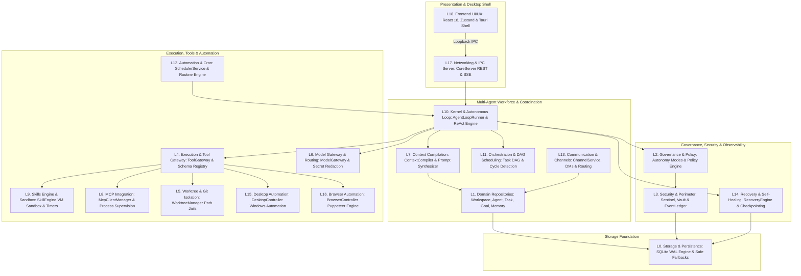
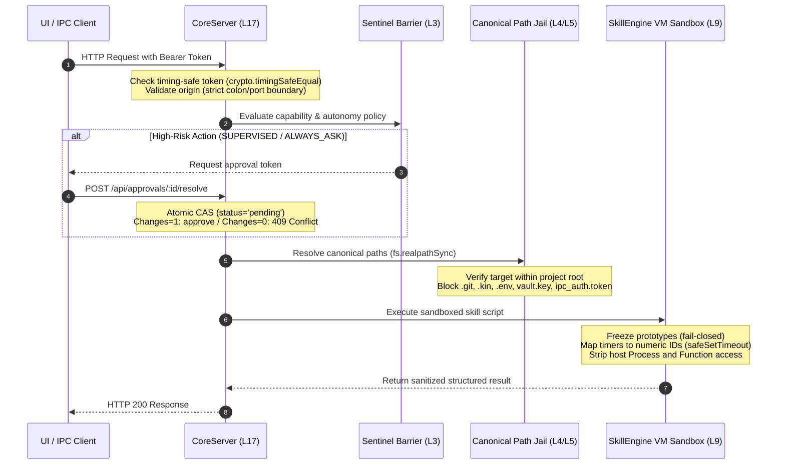
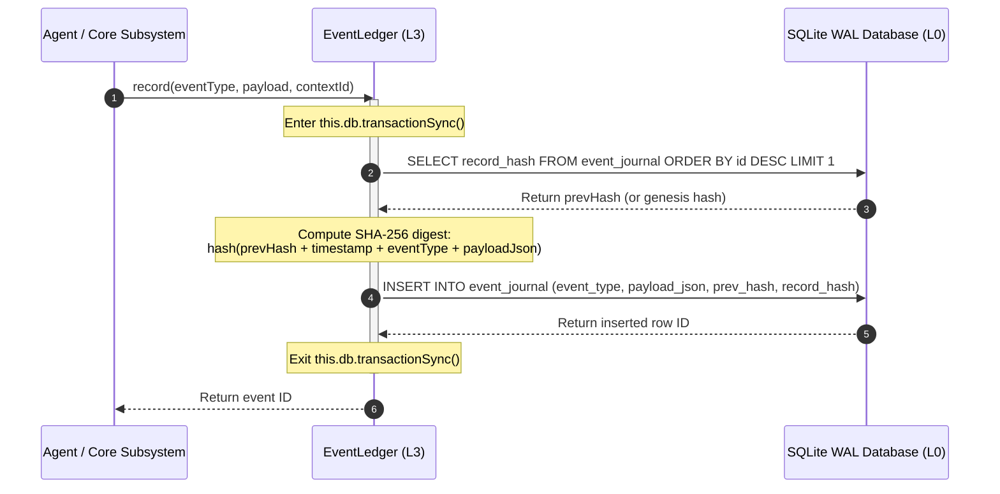
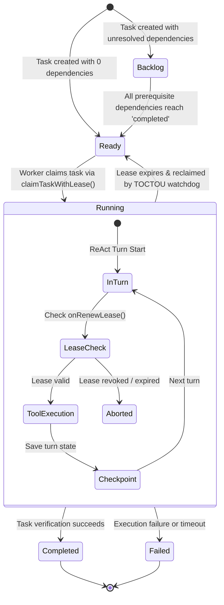
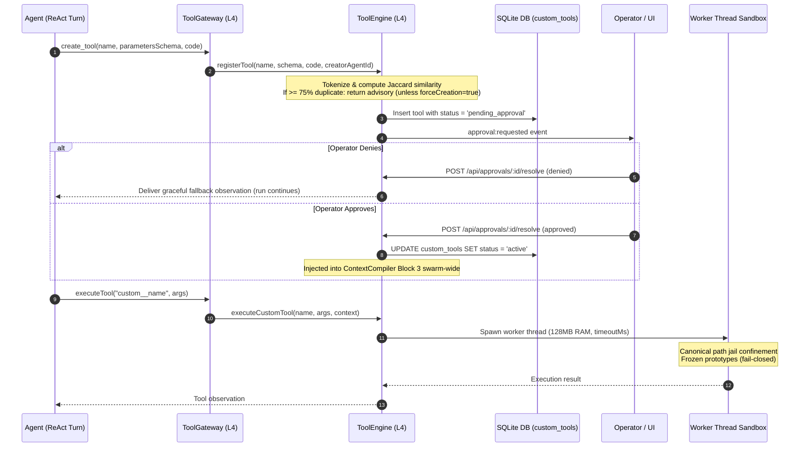
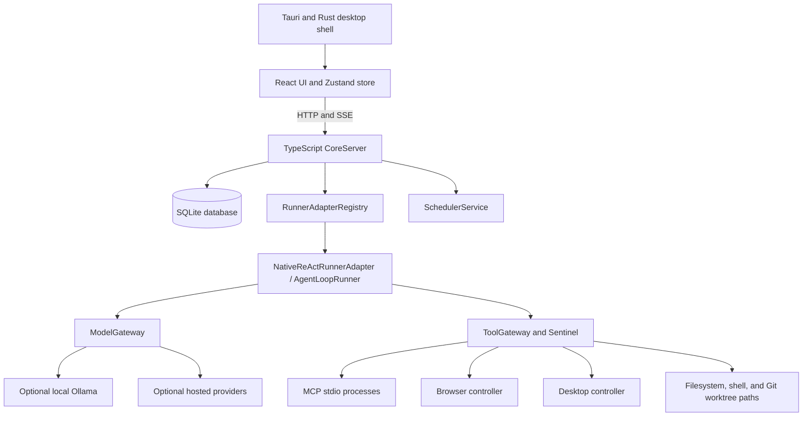

# KIN architecture

This document summarizes the architecture represented by the current source. It describes code boundaries, not an assurance that every subsystem is complete or verified in a packaged application. See [Current implementation notes](PROJECT_STATUS.md) for scope and limits. Product and technical requirements are maintained separately in [PRD](PRD.md) and [TRD](TRD.md).

## AI Agent Harness Architecture (18 Production Layers)

KIN organizes its agentic architecture into 18 discrete, production-hardened layers from L0 to L18 across `@kin/core` and `@kin/ui`:



| Layer | Harness Component | File Path | Implementation & Production Invariants |
|---|---|---|---|
| **L0 (Storage & Persistence)** | SQLite WAL Connection & DDL | `core/src/storage/db.ts` | Embedded SQLite WAL connection, migration runner, defensive fallback JSON parsing for corrupt rows, and schema DDL. |
| **L1 (Domain Repositories)** | Domain Repositories | `core/src/domain/` | Workspace, Agent, Task, Goal, and Memory repositories with resilient fallback parsing. |
| **L2 (Governance & Policy)** | Policy Engine & Autonomy | `core/src/policy/` | Autonomy modes (`AUTO`, `ALWAYS_ASK`, `FULL_ACCESS`), capability attenuation, financial safety gates, and action risk tiers. |
| **L3 (Security & Perimeter)** | Sentinel & EventLedger | `core/src/security/` | Sentinel fail-closed barrier, single-use approval tokens, AES-256-GCM vault, secret broker redaction, and transactional HMAC/SHA-256 event ledger. |
| **L4 (Execution & Tool Gateway)** | ToolGateway & ToolEngine | `core/src/execution/tool_gateway.ts`, `core/src/execution/tool_engine.ts` | Dynamic tool registration, schema introspection, dedicated `ToolEngine` Node.js `worker_threads` sandboxing (128MB RAM limit, configurable timeouts), tokenized Jaccard duplicate detection (75% advisory), operator pre-approval non-blocking gating, dynamic `custom__*` injection, and filesystem jail confinement. |
| **L5 (Worktree & Git Isolation)** | WorktreeManager | `core/src/execution/worktree_manager.ts` | Isolated Git worktrees, branch lifecycle, diff calculation, merge mutex, canonical path containment (`fs.realpathSync`), and `probeWorktree<T>()` candidate evaluation. |
| **L6 (Model Gateway & Routing)** | ModelGateway | `core/src/execution/model_gateway.ts` | Multi-provider LLM gateway (Ollama, OpenRouter, OpenAI, Anthropic, Gemini, DeepSeek, Groq), token quota budgeting, key rotation, and upstream error secret redaction. |
| **L7 (Context Compilation)** | ContextCompiler | `core/src/context/context_compiler.ts` | Sliding token budgets, 5-block prompt compilation, quote-reply thread trees, output spiller, and compaction engine. |
| **L8 (MCP Integration)** | McpClientManager | `core/src/execution/mcp_client.ts` | Model Context Protocol client supervisor with binary allowlists, dangerous environment stripping, clean process teardown, and live discovery. |
| **L9 (Skills Engine & Sandbox)** | SkillEngine | `core/src/skills/skill_engine.ts` | Procedural skills registry, isolated VM sandbox execution with numeric timer handles, fail-closed prototype freezing, and lesson harvesting (distinct from machine-executable `ToolEngine`). |
| **L10 (Kernel & Autonomous Loop)** | AgentLoopRunner & Kernel | `core/src/kernel/` | Multi-turn ReAct agent loop, lease renewal watchdogs, turn timeouts, state transitions, and coalesced wakeup queue. |
| **L11 (Orchestration & DAG Scheduling)** | Task DAG & Scheduling | `core/src/domain/task_repository.ts`, `core/src/kernel/` | Task dependency DAG, cycle detection (`wouldCreateCycle`), dependency existence validation, task backlog promotion, and workforce coordination. |
| **L12 (Automation & Cron)** | SchedulerService | `core/src/automation/scheduler.ts` | 5-field cron parsing, one-shot timer schedules, iteration limits, and proactive routine execution. |
| **L13 (Communication & Channels)** | ChannelService & Routing | `core/src/communication/` | Multi-agent departmental channels, private peer DMs with `INSERT OR IGNORE` concurrency resilience, loop breaker, activation engine, and deterministic message ordering. |
| **L14 (Recovery & Self-Healing)** | RecoveryEngine | `core/src/recovery/` | Observation verification, pre/post-action state checks, turn checkpointing, and startup crash/timeout self-healing. |
| **L15 (Desktop Automation)** | DesktopController | `core/src/computer/` | Desktop window controller, host desktop input automation, installed application launcher, and screen capture. |
| **L16 (Browser Automation)** | BrowserController | `core/src/browser/` | Persistent browser context, Playwright/Puppeteer driver, DOM inspection, and navigation history. |
| **L17 (Networking & IPC Server)** | CoreServer | `core/src/server/core_server.ts` | Core HTTP REST and SSE server, loopback IPC token authentication, strict CORS origin filtering, embedded static asset serving for `ui/dist` with SPA routing and cache headers, canonical symlink checks (`fs.realpathSync`), and git protected path guards. |
| **L18 (Frontend UI/UX)** | React 18, Zustand, Tauri Shell | `ui/src/`, `src-tauri/` | 4-pane collaborative workbench (`ui/src/`), Zustand reactive store (`kinStore.ts`), Tailwind CSS, connection health banner with automatic exponential backoff retry, DAG task dependency selector (`CreateTaskModal.tsx`), and Tauri Rust desktop shell with Node SEA sidecar binary execution. |

---

## Subsystem Interactions & Technical Specifications

### 1. Security Perimeter & Sandbox Isolation Subsystem

The security perimeter enforces defense-in-depth across the API boundary, process execution, and sandboxed skill scripts:



#### Security Boundary Invariants:
1. **VM Sandbox Timer Isolation**: Rather than returning host `NodeJS.Timeout` objects (which expose constructor traversal to the outer V8 realm's unrestricted `Function` constructor), `safeSetTimeout` allocates an opaque integer ID stored in an outer `Map<number, NodeJS.Timeout>`. The sandbox receives strictly the integer ID, preventing prototype breakout attacks.
2. **Fail-Closed Prototype Freezing**: When initializing sandbox context realms, prototype freezing is executed within guarded blocks. If freezing fails, the sandbox throws `CRITICAL_SANDBOX_FAILURE` immediately rather than executing untrusted code with unfrozen prototypes.
3. **Canonical Symlink Traversal Checks**: Path validation in `/api/projects/:id/artifacts/file` and `validateProjectBoundary` derives canonical paths via `fs.realpathSync`. Denylist patterns (`vault.key`, `ipc_auth.token`, `.env`, `.git/config`, `kin_storage.sqlite*`) are evaluated against both the requested path and the canonical realpath, preventing symlink jail escapes.
4. **Terminal Environment Sanitization**: Process executions in `core_server.ts` pass sanitized environments via `McpClientManager.sanitizeMcpEnv()`, stripping sensitive variables (`KIN_VAULT_KEY`, `KIN_IPC_TOKEN`, cloud tokens) before executing child shell commands.
5. **Constant-Time Token Comparison**: Operator sign-off tokens are compared using `crypto.timingSafeEqual` after buffer length verification, eliminating timing side channels.
6. **Strict CORS Origin Filtering**: Loopback CORS verification requires explicit colon/port boundaries (`http://localhost:` and `http://127.0.0.1:`), rejecting spoofed origins such as `http://localhost.attacker.com`.
7. **Upstream LLM Secret Redaction**: Raw error text returned by LLM providers is sanitized by `SecretBroker.getInstance().redactSecrets()` before throwing, ensuring API keys and authorization headers never leak into logs or telemetry.
8. **Git Protected Path Confinement**: Working tree revert and stage endpoints verify paths against `.git`, `.kin`, `.env` and return HTTP 403 for protected files.

---

### 2. Transactional EventLedger Subsystem

The EventLedger provides a tamper-evident audit journal of all governance decisions, agent actions, approvals, and mutations:



#### EventLedger Invariants:
1. **Linear Cryptographic Hashing**: Every record stores the SHA-256 digest of the previous record's hash concatenated with event metadata and canonical JSON payload, forming an unbroken cryptographic chain from the genesis record.
2. **Transactional Concurrency Fencing**: Reading `prevHash`, calculating the digest, and inserting the new record are encapsulated within `this.db.transactionSync()`. Under SQLite WAL mode, this serializes concurrent writes, eliminating hash chain forking under parallel multi-agent activity.
3. **Chain Integrity Verification**: `verifyChainIntegrity()` traverses the journal sequentially from row 1 to row N, recomputing expected digests. It identifies any payload mutations, deletions, or link corruptions and returns the exact compromised row ID.

---

### 3. Task DAG Scheduler & Concurrency Control Subsystem

Task execution is organized into a Directed Acyclic Graph (DAG) with dependency ordering, lease management, and non-blocking background promotion:



#### Task Scheduler Invariants:
1. **DAG Cycle Prevention**: `TaskRepository.createTask` performs depth-first cycle detection (`wouldCreateCycle(taskId, depId)`) before inserting dependency edges. Attempts to create circular dependencies throw descriptive errors immediately.
2. **Dependency Existence Validation**: All dependency task IDs specified in `dependsOnTaskIds` must exist in SQLite; otherwise, creation is rejected to prevent permanent backlog starvation.
3. **Backlog Initialization**: Tasks with pending dependencies initialize with status `'backlog'`. When a task reaches `'completed'`, `promoteReadyTasks()` evaluates downstream dependents and promotes those with all satisfied dependencies to `'ready'`.
4. **Atomic Lease Claiming**: Workers acquire execution leases using conditional SQL:
   ```sql
   UPDATE tasks
   SET status = 'running', assigned_agent_id = ?, claimed_by_run_id = ?, lease_expires_at = ?, updated_at = ?
   WHERE id = ? AND (status IN ('ready', 'backlog') OR (status = 'running' AND lease_expires_at < ?))
   ```
   Exactly one worker transitions the row; rival workers receive zero changes and stand down.
5. **TOCTOU-Safe Lease Reclamation**: `reclaimExpiredTaskLeases` includes timestamp fencing (`AND (lease_expires_at IS NULL OR lease_expires_at < ?)`), preventing the scheduler from stealing a task lease that was renewed between candidate selection and update execution.
6. **ReAct Loop Lease Watchdog**: `AgentLoopRunner` evaluates `options.onRenewLease` at the start of each turn. If lease renewal returns `false`, execution terminates immediately with `interrupted: true`, preventing runaway worker processes.
7. **DM Auto-Provisioning Concurrency Resilience**: Peer-to-peer direct message channels utilize `INSERT OR IGNORE INTO channels`, eliminating primary key collisions when two agents initiate conversation simultaneously.
8. **Deterministic Message Ordering**: Channel message retrieval applies composite ordering (`ORDER BY created_at DESC, id DESC` in the subquery and `ORDER BY created_at ASC, id ASC` in the outer query), eliminating non-deterministic display ordering during same-millisecond bursts.

---

### 4. Dynamic Machine-Executable Tools & Harness² Recursive Upgrades Subsystem

Grounded in Google Research Harness² recursive harness principles, KIN decouples human-readable procedural instructions from high-performance, machine-executable dynamic tools created at runtime:



#### Dynamic Tool & Harness² Invariants:
1. **Clean-Break Execution Architecture**: `SkillEngine` (`core/src/skills/skill_engine.ts`) manages procedural natural language prompts, YAML frontmatter, and VM sandboxing. `ToolEngine` (`core/src/execution/tool_engine.ts`) executes machine-executable TypeScript/JavaScript within isolated Node.js `worker_threads`.
2. **Worker Thread Resource Jailing**: Dynamic worker processes are capped at 128MB memory ceiling and enforced by configurable timeouts (`executionContext.timeoutMs`, default 15s).
3. **Tokenized Duplicate Interception**: Tool synthesis checks incoming code and schema against registered tools using tokenized Jaccard similarity. Tools with $\ge 75\%$ similarity return a `duplicate_advisory` to avoid tool bloat. Agents can pass `forceCreation: true` to bypass directly to operator review and prevent infinite debating loops.
4. **Non-Blocking Approval Gating**: In supervised or AUTO mode, unapproved tools require operator pre-approval. If denied, the agent receives an explanatory observation rather than terminating the run, allowing graceful fallback to alternate strategies.
5. **Swarm-Wide Tool Distribution**: Approved custom tools are dynamically exposed via `ToolGateway` (prefixed as `custom__<name>`) and injected into `ContextCompiler` Block 3 across all agents in the project.
6. **Isolated Candidate Evaluation (`probeWorktree`)**: Agents can test code changes and tooling patches inside isolated Git worktrees via `WorktreeManager.probeWorktree<T>()`, capturing execution success, test output, and return results without modifying the working tree.
7. **Cross-Task Improvement Library**: Grounded in Harness² domain adaptation, recurring failure patterns and self-healing fixes are cataloged in `harness_improvements` (`recordImprovement`, `findImprovements`) and surfaced during context compilation.

---

## Runtime overview



## Components

### Desktop and interface

`src-tauri/` contains the Tauri application, Rust startup/supervision code, and platform-specific desktop integration. `ui/` contains the React interface and Zustand store. The UI communicates with the TypeScript core over local HTTP and Server-Sent Events; Tauri packaging and browser-based development are distinct launch modes.

### Core service and persistence

`core/src/server/core_server.ts` constructs and connects the runtime services, starts the local HTTP server, and exposes API routes and SSE events. The default listener uses `127.0.0.1:54321`; the daemon can select another port with `KIN_PORT`.

`core/src/storage/` initializes SQLite and migrations. Domain repositories manage projects, agents, tasks, goals, channels, and memory. The event ledger records structured events. Application state and project files are local by default, while integrations may make external requests.

### Agent execution and workforce runtime

KIN organizes agents within a project-scoped organization boundary. Every project maintains its own isolated Boss orchestrator (`agent-boss-${projectId}`) and specialist coworkers.

- `RunnerAdapter`: A pluggable interface and registry (`core/src/kernel/runner_adapter.ts`) decoupling execution engines from KIN's state and security authority. The default engine is `NativeReActRunnerAdapter`, wrapping `AgentLoopRunner`.
- `4-Tier Memory Scoping`:
  - **Tier 1 (Project-Shared Memory)**: Project goals, architectural decisions, and project memories accessible to all project coworkers.
  - **Tier 2 (Conversation-Scoped Context)**: Channel message trajectories and channel memories accessible to enrolled channel members.
  - **Tier 3 (Agent-Private Memory)**: Personal agent reflections, learned skills, and scratchpad state (`scope: 'agent_private'`).
  - **Tier 4 (Direct Message Privacy)**: Direct messages between the operator and an agent, or peer-to-peer between two coworker agents (`dm-${agentA}-${agentB}`), isolated strictly to participants.
- `Workforce Coordination`: Tools for `hireSpecialist`, `assignCoworker` (channel enrollment), `callMeeting` (convening departments with agendas), `sendDirectMessage`, `channel_post` (cross-channel announcements & decision record posting), and `delegateToAgent`.
- `Operator Inspection Mode`: The operator can monitor peer coworker direct messages in real time with live thought streaming and intervention controls.
- `ContextCompiler`: Gathers agent, project, task, channel, tiered memory, and skill context into deterministic prompt blocks.
- `WakeupQueue`: Coalesces pending wakeups in process memory; durable run and task state is stored separately.

Task leases coordinate claims in SQLite. The source includes checkpointing and startup recovery paths, but those mechanisms should not be read as exact replay or lossless recovery assurances.

### Models and credentials

`ModelGateway` handles provider model discovery and inference adapters, including Ollama and configured hosted providers. `SecretVault` and `SecretBroker` manage credentials and secret substitution/redaction paths. Model catalogs and configured-key status do not prove successful inference; the selected provider must accept a real request.

Hosted requests send the prompt and context supplied to that provider off-device. Ollama can run inference locally when available, but other application features may still use network connections.

### Tools and integrations

`ToolGateway` builds tool schemas and dispatches filesystem, shell, scheduling, browser, desktop, skill, and MCP calls. `Sentinel` evaluates tool authorization and approvals. Several direct HTTP control endpoints also exist, so a single gateway diagram should not be interpreted as proof that every privileged action shares one enforcement path.

MCP configuration is read from supported project configuration locations by `McpClientManager`. MCP servers run as child processes and can receive the tool arguments sent to them. Review server commands and configuration before enabling them.

The browser and desktop controllers use host capabilities. A tool approval or project path check is an application control rather than hardware-level process isolation. Chromium flags, host permissions, and platform behavior affect the actual boundary.

Git worktrees provide a separate working directory for supported coding tasks, serialized via an AsyncMutex lock. They do not isolate child processes, host credentials, or network access.

### Scheduling

`SchedulerService` stores one-shot and recurring schedules in SQLite. Recurring schedules use a five-field cron parser and next-occurrence calculator in `cron_calendar.ts`. The service records dispatch attempts and supports retry paths. Scheduler state does not ensure that a target model or downstream task will complete successfully.

## Data and trust boundaries

```text
Local UI / Tauri window
        │ local HTTP + SSE
        ▼
CoreServer ───── SQLite and local project files
   │
   ├── Ollama (local service, if configured)
   ├── Hosted model provider (prompt/context leave the machine)
   ├── Browser destination (network request to visited site)
   └── MCP process/service (receives tool arguments)
```

Treat model output, browser content, MCP responses, imported skills, project files, and user-provided prompts as untrusted input. Application-level approvals and capability checks reduce risk but should not be described as a host security boundary.

## Source map

| Area | Main path |
|---|---|
| HTTP/SSE API and service assembly | `core/src/server/core_server.ts` |
| Run state and execution loop | `core/src/kernel/agent_loop.ts` |
| Pluggable runner adapters | `core/src/kernel/runner_adapter.ts` |
| Context compiler and memory tiering | `core/src/context/context_compiler.ts` |
| Communication and activation | `core/src/communication/` |
| Domain persistence | `core/src/domain/` |
| SQLite schema and migrations | `core/src/storage/` |
| Model providers | `core/src/execution/model_gateway.ts` |
| Tools, ToolEngine, and MCP | `core/src/execution/tool_gateway.ts`, `core/src/execution/tool_engine.ts`, `core/src/execution/mcp_client.ts` |
| Git worktree isolation and candidate probing | `core/src/execution/worktree_manager.ts` |
| Authorization and secrets | `core/src/security/` |
| Scheduler | `core/src/automation/` |
| Skills | `core/src/skills/` |
| UI state and components | `ui/src/` |
| Desktop shell | `src-tauri/src/` |
